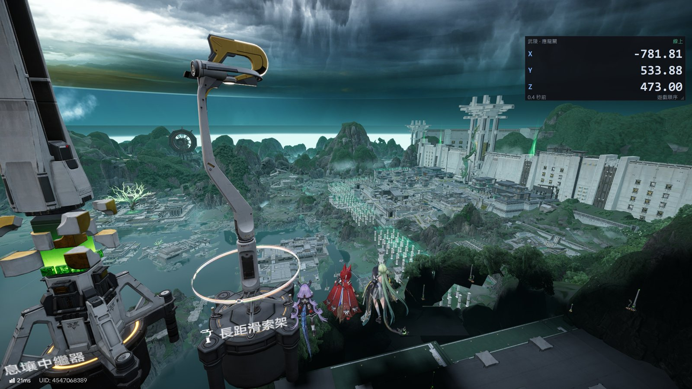
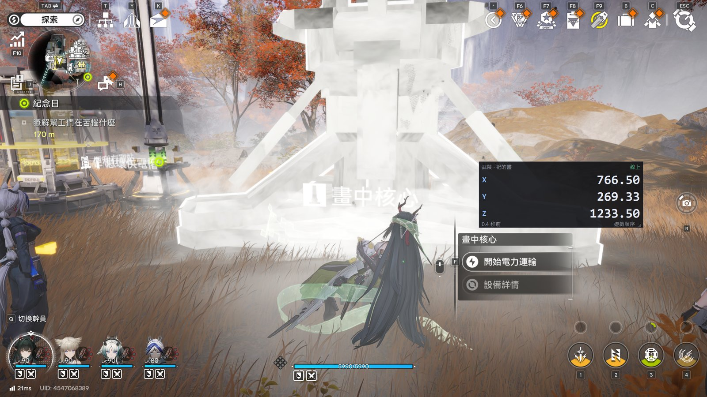

# Endfield 座標浮窗（endfield-pos-overlay）

[English](README.en.md)

把官方《明日方舟：終末地》網頁地圖（`https://game.skport.com/map/endfield`）同步到的角色座標，顯示在一個**永遠置頂、可拖曳、可縮放**的小視窗裡，邊玩邊看、點一下就複製。



> 非官方工具，與 GRYPHLINE / Hypergryph 無關。只讀：不改、不擋、不送出任何遊戲或網站資料；座標只送到你自己電腦上的 `127.0.0.1`。

## 運作方式

```
官方地圖網頁（你的瀏覽器，已登入、「位置同步」切到 ON）
   │  使用者腳本攔下頁面自己收到的位置訊息（約每秒一筆）
   ▼
http://127.0.0.1:27600/pos   ← 浮窗程式在本機開的接收埠
   ▼
置頂浮窗
```

兩個零件：

| 零件 | 說明 |
|---|---|
| `userscript/endfield-pos-relay.user.js` | 瀏覽器使用者腳本（Tampermonkey / Violentmonkey），Chrome、Edge、Firefox 都可以 |
| 浮窗程式 | Windows：`endfield-pos-overlay.exe`；macOS：`.app`；或用 Python 3.10+ 直接跑原始碼 |

## 安裝

三步：裝 Tampermonkey → 裝腳本 → 下載浮窗程式。每一步結尾有「確認」，做完看一下，可以省掉大半的排查。

### 1. 瀏覽器裝使用者腳本管理器

| 瀏覽器 | 擴充套件 | 額外設定 |
|---|---|---|
| Chrome | [Tampermonkey](https://chromewebstore.google.com/detail/dhdgffkkebhmkfjojejmpbldmpobfkfo) | 把 `chrome://extensions/?id=dhdgffkkebhmkfjojejmpbldmpobfkfo` 貼到網址列（這就是 Tampermonkey 的「詳細資料」頁）→ 往下找「**允許使用者指令碼**」打開。舊版 Chrome 沒有這個開關：改到 `chrome://extensions` 右上角打開「開發人員模式」 |
| Edge | [Tampermonkey](https://microsoftedge.microsoft.com/addons/detail/iikmkjmpaadaobahmlepeloendndfphd) | 同上：貼 `edge://extensions/?id=iikmkjmpaadaobahmlepeloendndfphd` → 打開「允許使用者指令碼」；或打開「開發人員模式」 |
| Firefox | [Tampermonkey](https://addons.mozilla.org/firefox/addon/tampermonkey/) 或 [Violentmonkey](https://addons.mozilla.org/firefox/addon/violentmonkey/) | 無 |

找不到那一頁的話：在瀏覽器右上角的 Tampermonkey 圖示上按右鍵 →「管理擴充功能」，就是同一頁。Tampermonkey 官方 FAQ 有每一步的截圖：[Permission to execute userscripts](https://www.tampermonkey.net/faq.php?q=Q209)。

**確認**：Tampermonkey 詳細資料頁裡「允許使用者指令碼」是打開的。沒開的話，腳本裝得進去但永遠不會執行，而且不會有任何錯誤訊息。同一頁的「Service Worker」、「檢視畫面」連結是給開發者用的，跟本工具無關。

### 2. 安裝腳本

在瀏覽器裡點這個連結：**[安裝 endfield-pos-relay.user.js](https://raw.githubusercontent.com/moonstarsky37/endfield-pos-overlay/main/userscript/endfield-pos-relay.user.js)**，Tampermonkey 會跳出安裝畫面 → 按「安裝」。之後腳本有新版會自動更新。

- 出現「使用者腳本**重新安裝**」畫面，代表已經裝過。看「已安裝版本」：比連結上的版本舊就按「重新安裝」，一樣就按「取消」。
- 點了連結只是下載一個檔案、沒有安裝畫面：第 1 步沒完成（Tampermonkey 沒裝，或「允許使用者指令碼」沒開）。
- **不要**把 `.user.js` 下載下來雙擊：它不是程式，雙擊會跳出「Windows Script Host」的錯誤視窗。
- 離線安裝：把 `.user.js` 檔拖進瀏覽器視窗，或在 Tampermonkey 的「新增腳本」貼上內容。

**確認**：點瀏覽器右上角的 Tampermonkey 圖示，清單裡有「Endfield 座標中繼」而且開關是開的。

### 3. 下載浮窗程式

到 [Releases](../../releases) 下載：

- **Windows**：`endfield-pos-overlay-windows.exe`，放哪都可以，雙擊執行。
  第一次執行 SmartScreen 可能顯示「Windows 已保護您的電腦」（程式沒有付費簽章）→「其他資訊」→「仍要執行」。
- **macOS**：`endfield-pos-overlay-macos.zip`，解壓後把 `.app` 拖到「應用程式」。
  第一次開啟要**按右鍵 →「打開」**（程式沒有經過 Apple 公證）。

會 Python 的話也可以直接跑原始碼（只用標準函式庫，不用裝任何套件）：

```
python run_overlay.py
```

Windows 可雙擊 `start-overlay.cmd`，macOS 可雙擊 `start-overlay.command`。

**確認**：程式開起來有一個黑色小視窗，寫「等待網頁同步位置…」。

## 使用

1. 開浮窗程式。
2. 瀏覽器開 [官方地圖](https://game.skport.com/map/endfield)、登入、把「**位置同步**」切到 ON。
   網址帶語言（`/zh-tw/map/…`、`/en/map/…`）也可以。
3. 看三個地方，都對了就是成功：

| 看哪裡 | 成功的樣子 |
|---|---|
| 地圖頁右下角 | 一行小字「座標中繼：送出中」 |
| Tampermonkey 圖示 | 圖示上有數字 1（這一頁有一個腳本在跑） |
| 浮窗 | 約一秒更新一次 |



| 操作 | 效果 |
|---|---|
| 左鍵拖曳 | 移動視窗 |
| 右下角 ◢ 拖曳 | 改大小，字跟著縮放 |
| Ctrl + 滾輪（macOS：⌘ + 滾輪） | 調字級 |
| 左鍵點一下數字 | 複製 `x y z` 到剪貼簿 |
| 右鍵（macOS：右鍵或 Control + 點） | 選單：複製、座標順序、透明度、字級、重設、語言、結束 |

- 座標預設是**遊戲原始順序**（`x y z`，`y` 是高度）。右鍵可切成 **Blender 順序**（`x z y`，Z 朝上）。
- 超過 5 秒沒有新資料，數字會變灰；網頁斷線時顯示「網頁已離線」。
- 設定（位置、大小、字級、透明度、順序、語言）會自動儲存：
  Windows `%APPDATA%\endfield-pos-overlay\state.json`；macOS `~/Library/Application Support/endfield-pos-overlay/state.json`。

### 命令列參數

```
--port 27600        接收埠（改了的話，腳本也要改：擴充套件選單 →「設定浮窗接收埠」）
--lang auto|zh|en   介面語言
--alpha 0.9         透明度 0.2–1.0
--state-file PATH   設定檔位置
```

## 疑難排解

先看這三個地方，就知道卡在哪一段：

| 看哪裡 | 正常 | 不正常代表 |
|---|---|---|
| 地圖頁右下角的小字 | 「座標中繼：送出中」 | **沒有小字**：腳本沒在這頁執行 → 回安裝第 1、2 步的「確認」；腳本要 0.2.1 以上（舊版不認帶語言的網址，再點一次安裝連結就會更新）。**「連不到 127.0.0.1:27600」**：浮窗沒開。**「等待」**：「位置同步」沒切到 ON |
| 瀏覽器開 `http://127.0.0.1:27600/health` | 類似 `{"ok": true, "last_update_age_s": 0.3, "frames": 123}`，`frames` 大於 0 | **打不開**：浮窗沒開。**`frames` 是 0**：腳本從來沒送過東西，同上一列「沒有小字」 |
| 浮窗 | 數字每秒更新 | 一直「等待網頁同步位置…」：看上面兩列 |

會用 F12 的人可以再確認官網那一端：地圖頁按 F12 → 網路 → WS → 點 `map` → 訊息。有 `"type":1012` 的訊息一直進來，代表官網有送座標，問題在腳本或浮窗；沒有，代表「位置同步」沒生效，關掉再開一次。

| 狀況 | 處理 |
|---|---|
| 雙擊 `.user.js` 跳出「Windows Script Host」錯誤 | 這個檔案不能雙擊執行。先裝 Tampermonkey（安裝第 1 步），再在瀏覽器裡點安裝連結（第 2 步） |
| 浮窗一啟動就跳「無法在 127.0.0.1:27600 開啟接收埠」 | 已經有一個浮窗在跑，或埠被別的程式占用。關掉舊的，或換埠（`--port 27601`，腳本選單也要改） |
| 頁面小字「掛鉤失敗」 | 腳本的 `@sandbox` 被改成 `DOM` 了；在 Tampermonkey 編輯腳本，保持 `@sandbox raw`，然後重新整理頁面 |
| 浮窗在遊戲裡看不到 | 遊戲改成「**無邊框視窗**」模式；獨占全螢幕會蓋掉所有置頂視窗。macOS 的全螢幕 App 也一樣（在另一個桌面空間） |
| 數字變灰 | 超過 5 秒沒新資料：瀏覽器分頁被休眠或斷線。把地圖分頁留在前景或關掉該分頁的省電休眠 |

小字最後的 `inject` / `page` / `sandbox` 是腳本用哪種方式掛上的。回報問題時請附上：那行小字、`/health` 顯示的內容、瀏覽器與 Tampermonkey 版本。

## 限制

- 只有地圖分頁開著、而且「位置同步」是 ON 時才有資料。
- 一秒一筆是官方伺服器的推送頻率，浮窗不會更快。
- 官方網站改版可能讓腳本失效；請開 issue。
- macOS 版沒有在實機上完整驗證過，歡迎回報。
- 區域英文名尚未收錄（英文介面先顯示區域代號），歡迎 PR 補上官方英文名。

## 安全

- 浮窗只聽 `127.0.0.1`（外部電腦連不到）。
- 只接受使用者腳本管理器送來的請求；其他網站送的請求一律拒絕（防止別的網頁塞假座標）。
- 腳本不讀、不送你的登入資訊；只轉送位置訊息（type 1011 / 1012 / 1013）。

## 開發

```
python -m unittest                                               # 單元測試（標準函式庫）
uv run --with playwright python tools/test_userscript.py         # 腳本端對端測試（假地圖頁 + 假 WebSocket）
```

打包由 GitHub Actions 處理（`.github/workflows/build.yml`）：推 `v*` tag 就會建 Windows exe 與 macOS app 並發佈 Release。

## 授權

MIT
